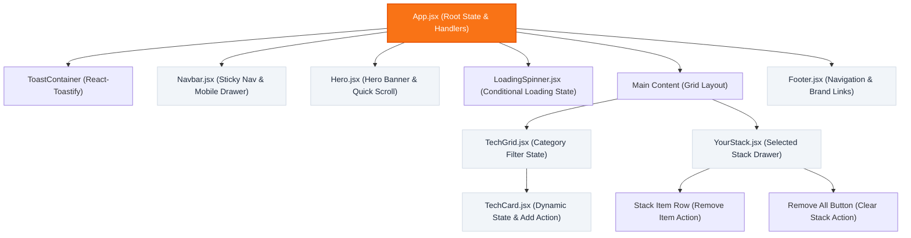

# 🧱 DevStack — Build Your Ideal Development Stack

<div align="center">

  

  <p align="center">
    <strong>A high-performance, interactive tech stack builder for modern developers and software engineering teams.</strong><br />
    <em>Discover, compare, filter, and assemble your production-ready development stack with real-time reactive feedback.</em>
  </p>

  <p align="center">
    <a href="https://react.dev/"></a>
    <a href="https://vitejs.dev/"></a>
    <a href="https://tailwindcss.com/"></a>
    <a href="https://fkhadra.github.io/react-toastify/"></a>
    <a href="https://lucide.dev/"></a>
    <a href="LICENSE"></a>
  </p>

  <p align="center">
    <a href="#-project-links">Project Links</a> •
    <a href="#-key-features">Key Features</a> •
    <a href="#-ui-showcase--preview">UI Showcase</a> •
    <a href="#-system-architecture">Architecture</a> •
    <a href="#-technologies-used">Tech Stack</a> •
    <a href="#-getting-started">Getting Started</a> •
    <a href="#-react-conceptual-questions--answers">React Concepts (Q&A)</a> •
    <a href="#-directory-structure">Structure</a>
  </p>

</div>

---

## 🔗 Project Links

* **GitHub Repository:** [https://github.com/Perseus2700/Assignment-5](https://github.com/Perseus2700/Assignment-5)
* **Live Application:** [https://github.com/Perseus2700/Assignment-5](https://github.com/Perseus2700/Assignment-5) *(Deployable on Vercel / Netlify / Surge)*
* **Course & Cohort:** Programming Hero — Batch 14 (Assignment 5)

---

## 💡 Overview

**DevStack** is a responsive single-page web application engineered to simplify technology decision-making. Developers can browse an asynchronously loaded catalogue of industry-standard tools across six key disciplines (Frontend, Backend, Database, Language, Styling, and DevOps), inspect ratings and difficulty levels, and curate an integrated stack in a dedicated, persistent drawer workspace.

Every action—from adding tools and detecting duplicates to single-item removal and complete workspace wipeouts—is backed by real-time reactive UI updates and custom-animated sensory toast notifications.

---

## 🌟 Key Features

### 1. ⚡ Interactive Stack Builder with Duplicate Prevention
- **One-Click Addition:** Instantly add any technology from the catalogue directly into your dedicated "Your Stack" drawer.
- **Smart Button State Toggling:** Technology cards dynamically evaluate selection state; once added, the button transitions from active `+ Add to Stack` to a disabled, confirmed `✓ Added to Stack` state.
- **Guard Clause Safeguards:** Prevents duplicate entries with immediate alert warnings, guaranteeing data integrity in your stack list.

### 2. 🗂️ Multi-Domain Taxonomy & Instant Filter System
- **6 Domain Categories:** Filter seamlessly across `Frontend`, `Backend`, `Database`, `Language`, `Styling`, and `DevOps`.
- **Zero-Lag React Filtering:** Instant client-side state filtering enables smooth categorization transitions without page reloads or layout shift.
- **Scrollable Category Pill Bar:** Modern horizontal pill navigation with active state highlights and hover feedback.

### 3. 📦 Dedicated "Your Stack" Drawer Workspace
- **Live Counter Telemetry:** Real-time badge counter indicating the exact number of technologies selected.
- **Granular Deletion:** Remove individual technologies directly with the quick-action delete button (`✕`), instantly re-enabling them in the catalogue.
- **Bulk Reset ("Remove All"):** Single-click reset to empty the entire stack workspace with confirmation feedback.
- **Intuitive Empty State:** Clean dashed placeholder indicating when no technologies have been added yet.

### 4. 🔔 Dynamic Notification Feedback Loop (React-Toastify)
- **Contextual Notifications:** Toast alerts configured with bespoke visual styling, auto-dismiss timers, and distinct emoji indicators:
  - 🎉 **Success:** Confirmation when a new technology is added.
  - ⚠️ **Warning:** Instant alert when an existing item is re-clicked.
  - 🗑️ **Info:** Notification upon removing an item from the stack.
  - 🧹 **Error/Reset:** Alert notifying when the entire stack is wiped.
  - 🔐 **Auth Placeholder:** Friendly feedback when clicking sign-in/register actions.

### 5. 📱 Fully Responsive Layout & Sticky Sidebar
- **Adaptive Grid System:** 3-column desktop grid, 2-column tablet layout, and 1-column mobile view with touch-optimized targets.
- **Sticky Desktop Drawer:** The "Your Stack" sidebar remains pinned in viewport (`sticky top-24`) while scrolling through extensive tech lists.
- **Mobile Navigation Drawer:** Responsive navbar with collapsible hamburger menu, touch transitions, and smooth anchor scrolling.

### 6. 🎨 Centralized CSS-Variable Brand Theme
- **Consistent Brand Identity:** Unified signature gradient (`#f97316` orange → `#ec4899` pink → `#8b5cf6` violet) controlled via central CSS variables (`--brand-gradient`).
- **Single-Point Customization:** Theme updates propagate globally across hero typography, CTA buttons, and interactive highlights.

---

## 📸 UI Showcase & Preview

<div align="center">

### Complete Application Dashboard


</div>

<br />

| Empty Stack State (`ui/YourStack-without.png`) | Populated Stack State (`ui/YourStack-with.png`) |
| :---: | :---: |
|  |  |
| *Dashed placeholder when no tools are selected* | *Real-time count, item badges & individual delete controls* |

---

## 🏗️ System Architecture

### Component Hierarchy & Data Flow



### Unidirectional Data Flow Explained
- **State Lifting:** The central state (`technologies`, `loading`, `selectedStack`) is hoisted in [`App.jsx`](src/App.jsx).
- **Downward Props:** Selected stack data and catalog items flow downward into [`TechGrid.jsx`](src/components/TechGrid.jsx) and [`YourStack.jsx`](src/components/YourStack.jsx).
- **Upward Event Bubbling:** Child actions (`onAddTech`, `onRemove`, `onRemoveAll`) bubble up via callback handlers to update parent state, triggering automatic reconciliation.

---

## 🛠️ Technologies Used

| Category | Technology | Version | Purpose in Application |
| :--- | :--- | :--- | :--- |
| **Core Framework** | [React](https://react.dev/) | `^18.3.1` | Component-driven declarative UI architecture, Virtual DOM, and state management |
| **Build Tool** | [Vite](https://vitejs.dev/) | `^6.0.7` | Lightning-fast development server, HMR (Hot Module Replacement), and optimized rollup bundling |
| **Styling** | [Tailwind CSS](https://tailwindcss.com/) | `^3.4.17` | Utility-first responsive CSS styling with custom brand color tokens |
| **CSS Extensions** | PostCSS & Autoprefixer | `^8.4.49` | CSS parsing, vendor prefixing, and browser compatibility |
| **Icons** | [Lucide React](https://lucide.dev/) | `^1.16.0` | Accessible, tree-shakeable SVG icons for UI navigation and actions |
| **Tech Logos** | [Devicon CDN](https://devicon.dev/) | Latest | Vector badges and official tech logos for all catalog cards |
| **Notifications** | [React-Toastify](https://fkhadra.github.io/react-toastify/) | `^10.0.6` | Animated toast notification system with custom icons and position control |
| **Data Layer** | Standalone JSON | Async | Decoupled technological dataset stored in `public/technologies.json` |
| **Typography** | [Google Fonts (Inter)](https://fonts.google.com/specimen/Inter) | Clean Sans | Modern, legible typography system across all viewports |

---

## 📁 Directory Structure

```text
Assignment/
├── assets/                       # Static repository assets (logos, banner graphics)
│   ├── banner-stack.png          # 3D stack banner illustration
│   └── logo-text.png             # DevStack brand logo
├── public/                       # Vite public static assets
│   ├── assets/                   # Publicly served banner and logo images
│   └── technologies.json         # Master tech dataset (11 technologies, 6 categories)
├── src/
│   ├── components/
│   │   ├── Footer.jsx            # Multi-column footer with brand & external links
│   │   ├── Hero.jsx              # Hero banner with gradient heading & CTA buttons
│   │   ├── LoadingSpinner.jsx    # Pulsing spinner shown during data fetch
│   │   ├── Navbar.jsx            # Sticky navigation with mobile hamburger drawer
│   │   ├── TechCard.jsx          # Individual tech card with difficulty, ratings & badge
│   │   ├── TechGrid.jsx          # Category filter pills & responsive card grid
│   │   └── YourStack.jsx         # Sticky stack drawer with counter & remove controls
│   ├── styles/
│   │   └── index.css             # Tailwind directives & CSS custom variables (--brand-gradient)
│   ├── App.jsx                   # Root application component (state, handlers, layout)
│   └── main.jsx                  # React DOM root entry point
├── ui/                           # High-resolution screenshots of design & states
│   ├── full.png                  # Full application desktop screenshot
│   ├── YourStack-with.png        # Screenshot of drawer with selected technologies
│   ├── YourStack-without.png     # Screenshot of drawer in empty state
│   └── hamburger.png             # Mobile menu preview
├── index.html                    # Single-page HTML shell with SEO meta tags
├── package.json                  # Dependencies and execution scripts
├── tailwind.config.js            # Tailwind custom theme extensions
└── vite.config.js                # Vite plugin configuration for React
```

---

## 🚀 Getting Started

Follow these step-by-step instructions to set up, run, and build the project locally.

### Prerequisites
- **Node.js:** `v18.0.0` or higher ([Download Node.js](https://nodejs.org/))
- **npm:** `v9.0.0` or higher (bundled with Node.js) or `yarn` / `pnpm`

### 1. Clone the Repository
```bash
git clone https://github.com/Perseus2700/Assignment-5.git
cd Assignment-5/Assignment
```

### 2. Install Dependencies
```bash
npm install
```

### 3. Run the Development Server
```bash
npm run dev
```
Open your browser and navigate to:
```text
http://localhost:5173
```

### 4. Build for Production
```bash
npm run build
```
The optimized production bundle will be generated in the `dist/` directory.

### 5. Preview Production Build Locally
```bash
npm run preview
```

---

## 🧠 React Conceptual Questions & Answers

### 1. What is JSX, and why is it used in React?

**Answer:**  
**JSX (JavaScript XML)** is an XML/HTML-like syntax extension for JavaScript created for React. It enables developers to describe the visual structure of user interfaces directly within JavaScript code.

#### Why JSX is used:
1. **Declarative & Intuitive UI:** JSX allows developers to write UI markup that closely resembles HTML, making component templates readable, expressive, and easy to reason about.
2. **Co-location of Logic and Markup:** In modern component architecture, rendering logic (loops, conditionals) and UI structure are inherently connected. JSX keeps them tightly coupled inside a single file rather than artificially separating markup and logic across separate files.
3. **Compile-Time Optimization & Safety:** JSX is compiled during build time into standard `React.createElement()` JavaScript calls by tools like Babel or Vite (esbuild/SWC). This process catches syntax errors early and automatically escapes values to protect against Cross-Site Scripting (XSS) attacks.

---

### 2. What is the difference between props and state?

**Answer:**  
Both **props** and **state** are plain JavaScript objects used to hold data that influences component rendering, but they differ fundamentally in terms of ownership, mutability, and purpose:

| Dimension | Props (Properties) | State |
| :--- | :--- | :--- |
| **Definition** | Data passed from an external parent component down to a child component. | Data created, managed, and owned internally within the component itself. |
| **Mutability** | **Immutable (Read-Only):** A child component must never modify its received props directly. | **Mutable via setter:** Updated using state updater functions (e.g., `setState` / `setCount`). |
| **Scope** | Controlled by the parent component. | Private and local to the component where it is declared. |
| **Re-render Trigger** | Triggered when the parent re-renders or supplies new prop values. | Triggered whenever the state updater function is called with a new value. |
| **Project Example** | In [`TechCard.jsx`](src/components/TechCard.jsx), `tech`, `isAdded`, and `onAdd` are received as read-only props. | In [`App.jsx`](src/App.jsx), `selectedStack` is reactive state modified via `setSelectedStack`. |

---

### 3. What does the `useState` hook do, and where did you use it in this project?

**Answer:**  
The **`useState`** hook is a built-in React Hook that allows functional components to declare, maintain, and update local reactive state variables across renders. When the state setter function is called with a new value, React schedules a re-render of the component and updates the DOM to mirror the latest state.

#### Where `useState` was implemented in this project:
1. **[`App.jsx`](src/App.jsx):**
   - `const [technologies, setTechnologies] = useState([])`: Stores the array of technology objects loaded from `technologies.json`.
   - `const [loading, setLoading] = useState(true)`: Tracks the asynchronous data loading status to toggle the `LoadingSpinner`.
   - `const [selectedStack, setSelectedStack] = useState([])`: Maintains the user's active tech stack items array.
2. **[`Navbar.jsx`](src/components/Navbar.jsx):**
   - `const [mobileMenuOpen, setMobileMenuOpen] = useState(false)`: Controls whether the mobile navigation drawer is expanded or collapsed.
   - `const [activeNav, setActiveNav] = useState('Home')`: Highlights the currently active navigation item.
3. **[`TechGrid.jsx`](src/components/TechGrid.jsx):**
   - `const [activeCategory, setActiveCategory] = useState('All')`: Tracks the active filter pill to conditionally display matching technologies.

---

### 4. What does the `useEffect` hook do, and why did you need it to load the JSON data?

**Answer:**  
The **`useEffect`** hook enables functional components to perform side effects after rendering. Side effects include data fetching, manual DOM manipulations, subscriptions, timers, and logging.

#### Why `useEffect` was required to load the JSON data:
In React, functional components must remain pure with respect to rendering—they should not trigger asynchronous network calls directly in the component body, as this would cause infinite re-render loops on every state update.

```jsx
// App.jsx
useEffect(() => {
  setLoading(true);
  fetch('/technologies.json')
    .then((res) => {
      if (!res.ok) throw new Error('Failed to fetch technology data');
      return res.json();
    })
    .then((data) => {
      setTimeout(() => {
        setTechnologies(data);
        setLoading(false);
      }, 350); // Simulated micro-latency for smooth loading transitions
    })
    .catch((err) => {
      console.error('Error fetching data:', err);
      toast.error('Failed to load technologies. Please try again.');
      setLoading(false);
    });
}, []); // Empty dependency array [] ensures single execution on mount
```

- **Single Execution on Mount:** By providing an empty dependency array (`[]`), React guarantees the fetch request runs **exactly once** when the component first mounts to the DOM.
- **Asynchronous Hydration:** Once the data resolves, `setTechnologies(data)` and `setLoading(false)` are invoked to trigger a clean update of the UI without freezing the initial render.

---

### 5. Why does every item in a `.map()` list need a unique `key` prop?

**Answer:**  
When rendering dynamic lists in React using `.map()`, React requires each rendered item to have a unique and stable **`key`** prop.

#### Core Reasons:
1. **Virtual DOM Reconciliation & Diffing:** During reconciliation, React compares the new Virtual DOM tree with the previous one. Keys act as permanent unique identifiers for each DOM node.
2. **Minimal DOM Operations:** With unique keys, React can pinpoint precisely which elements were added, removed, or reordered without re-rendering the entire list. It reuses existing DOM elements instead of destroying and re-creating them, providing substantial performance optimization.
3. **Preventing State Glitches:** Without stable keys, React defaults to index-based tracking. If an item is deleted or prepended, component-internal state (such as input focus, animations, or checkboxes) can latch onto the wrong element, causing critical UI bugs.

*Example from [`TechGrid.jsx`](src/components/TechGrid.jsx):*
```jsx
{filteredTechnologies.map((tech) => (
  <TechCard
    key={tech.id}        {/* Unique, stable identifier from JSON dataset */}
    tech={tech}
    isAdded={addedIds.has(tech.id)}
    onAdd={onAddTech}
  />
))}
```

---

### 6. What is conditional rendering? Show one place you used it (example: the empty stack message).

**Answer:**  
**Conditional rendering** refers to the technique of displaying different UI elements, markup, or components dynamically based on certain boolean expressions or state conditions.

#### Implementation in [`YourStack.jsx`](src/components/YourStack.jsx):
In [`YourStack.jsx`](src/components/YourStack.jsx), conditional rendering alternates between a dashed empty-state placeholder and the active list of selected technologies based on `count === 0`:

```jsx
{/* Content: Empty State vs Selected Items */}
{count === 0 ? (
  /* State 1: When user has not added any technology */
  <div className="border border-dashed border-slate-200 rounded-2xl py-12 px-4 flex items-center justify-center text-center">
    <p className="text-slate-400 text-sm">
      Your stack is empty.
    </p>
  </div>
) : (
  /* State 2: When user has added 1 or more technologies */
  <div className="space-y-3">
    <div className="space-y-3 max-h-[460px] overflow-y-auto pr-1">
      {stack.map((item) => (
        <div key={item.id} className="border border-slate-200/90 rounded-2xl p-3.5 ...">
          {/* Technology icon, name, category, and remove button */}
        </div>
      ))}
    </div>

    {/* Remove All Action Button */}
    <div className="pt-3">
      <button type="button" onClick={onRemoveAll} className="w-full py-2.5 ...">
        Remove All
      </button>
    </div>
  </div>
)}
```

*Another instance appears in [`App.jsx`](src/App.jsx): displaying `<LoadingSpinner />` while `loading === true`, and rendering the content grid once `loading === false`.*

---

### 7. How do you pass data from a parent component to a child component, and how does a child send something back to the parent?

**Answer:**  
React enforces a strict **Unidirectional (Top-to-Bottom) Data Flow**:

```text
Parent Component (App.jsx)
   │
   ├── [1. Data flows DOWNWARDS via Props] ─────────► Child (TechCard.jsx)
   │                                                         │
   └── [2. Events bubble UPWARDS via Callback Props] ◄───────┘
```

#### 1. Passing Data Downwards (Parent to Child):
The parent component passes data as attributes (props) in JSX. The child component receives these as an argument object.

*Parent ([`TechGrid.jsx`](src/components/TechGrid.jsx)):*
```jsx
<TechCard
  tech={tech}               // Data object passed down
  isAdded={isAdded}         // Boolean flag passed down
  onAdd={onAddTech}         // Callback function reference passed down
/>
```
*Child ([`TechCard.jsx`](src/components/TechCard.jsx)):*
```jsx
export default function TechCard({ tech, isAdded, onAdd }) {
  // Access tech.name, tech.category, etc. directly from props
  return <h3>{tech.name}</h3>;
}
```

#### 2. Sending Data Upwards (Child to Parent):
Because props are read-only, a child cannot directly modify parent state. Instead:
1. The parent defines a handler function that updates its state (e.g., `handleAddToStack` in [`App.jsx`](src/App.jsx)).
2. The parent passes that function down to the child as a prop (`onAdd={handleAddToStack}`).
3. When an event occurs (such as a button click), the child executes the callback function, passing payload data back as arguments:

```jsx
// TechCard.jsx (Child Button Click)
<button
  type="button"
  disabled={isAdded}
  onClick={() => onAdd(tech)}   // Invokes parent callback with the specific tech object
>
  {isAdded ? '✓ Added to Stack' : '+ Add to Stack'}
</button>
```

When clicked, `handleAddToStack(tech)` runs in [`App.jsx`](src/App.jsx), updating the parent state and re-rendering the updated tree.

---

## 📋 Assignment Rubric Verification

| Requirement | Implementation Detail | Status |
| :--- | :--- | :---: |
| **Interactive Stack Builder** | Add cards to stack drawer, prevent duplicates, toggle added state | ✅ Completed |
| **Drawer Management** | Real-time counter, single item deletion, and "Remove All" bulk wipe | ✅ Completed |
| **Category Filtering** | 6 categories (`Frontend`, `Backend`, `Database`, `Language`, `Styling`, `DevOps`) | ✅ Completed |
| **Toast Notifications** | `React-Toastify` integrated for additions, duplicates, deletions & reset | ✅ Completed |
| **Responsive Design** | Pixel-perfect layout across mobile (hamburger menu), tablet, and desktop | ✅ Completed |
| **Conceptual Questions** | All 7 React conceptual questions answered thoroughly with code samples | ✅ Completed |
| **Clean Git History** | Meaningful commit messages documenting progress and features | ✅ Completed |

---

## 👨‍💻 Author & Acknowledgements

* **Developer:** [Perseus2700](https://github.com/Perseus2700)
* **Program:** Programming Hero — Batch 14 Web Development Course
* **Design Reference:** Figma & Penpot DevStack Specification

---

## 📄 License

This project is licensed under the [MIT License](LICENSE) — feel free to use and adapt it for learning and portfolio purposes.
